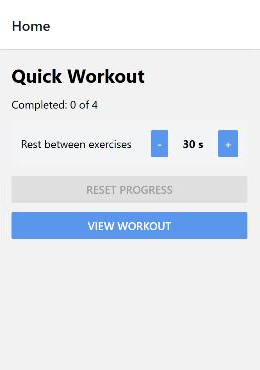
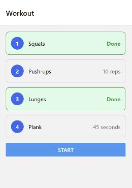

# WEB530 Test 2 – Practice Programming Question: Quick Workout

This is a practice question for Test 2. It is **harder and longer than the test** on purpose. It combines everything the test covers into one app, so if you can finish this, the test questions will feel familiar.

**How the test is different.** The test has **three shorter programming questions**, not one big one. Each focuses on one of the three parts below: sharing state with Jotai, styling in `styles.js`, and stack navigation. Each test question comes with its own starter Snack, already set up with the right `package.json` and files. You copy your answer into the answer box. The test uses different scenarios, so do not memorise this one. Practise the skills.

Total: 25 marks. Suggested time: 45 minutes. The test's three questions together are shorter than this.

## Before you start

- Open the React Native shell Snack at https://snack.expo.dev/@nick-romanidis/react-native-shell. Keep it on SDK 54, the default.
- Replace everything in `package.json` with the `package.json` below.
- Add a new file named `styles.js` next to `App.js`, and paste in the `styles.js` below.
- Replace everything in `App.js` with the `App.js` below.
- The **Web** preview is enough for this question.
- Use the course notes at https://seneca-ictoer.github.io/WEB530/ and CSS-Tricks' *A Complete Guide to Flexbox* at https://css-tricks.com/snippets/css/a-guide-to-flexbox/. The guide uses CSS names. In React Native they are camelCase (`justify-content` becomes `justifyContent`), and `flexDirection` starts as `"column"`.
- Every part below describes *behaviour*, not code. Do not use the Context API, and do not pass the workout data as props.
- On the test you will not be able to log in to Expo or save the Snack, so practise working in an unsaved Snack and copying your files somewhere safe every few minutes.

## Starter

_package.json_

```json
{
  "dependencies": {
    "@expo/vector-icons": "^15.0.3",
    "react-native-paper": "4.9.2",
    "react-native-screens": "~4.16.0",
    "@react-navigation/native": "^7.0.0",
    "@react-navigation/native-stack": "^7.0.0",
    "react-native-safe-area-context": "~5.6.0",
    "jotai": "*",
    "@types/react": "*"
  }
}
```

_styles.js_

```js
import { StyleSheet } from 'react-native';

export default StyleSheet.create({
  screen: {
    flex: 1,
    padding: 16,
    gap: 12,
  },
  // Part C: add your styles below this line.
});
```

_App.js_

```jsx
import { useState } from 'react';
import { View, Text, Button } from 'react-native';
// Add your navigation and Jotai imports here.
import styles from './styles';

const EXERCISES = [
  { name: 'Squats', detail: '15 reps' },
  { name: 'Push-ups', detail: '10 reps' },
  { name: 'Lunges', detail: '12 reps each leg' },
  { name: 'Plank', detail: '45 seconds' },
];

function HomeScreen() {
  const [rest, setRest] = useState(30);
  const completed = 0; // Part B: count the finished exercises from the atom.

  return (
    <View style={styles.screen}>
      <Text style={styles.title}>Quick Workout</Text>
      <Text>
        Completed: {completed} of {EXERCISES.length}
      </Text>
      <View style={styles.settingRow}>
        <Text>Rest between exercises</Text>
        <View style={styles.stepper}>
          <Button title="-" onPress={() => setRest((prev) => prev - 10)} />
          <Text style={styles.restValue}>{rest} s</Text>
          <Button title="+" onPress={() => setRest((prev) => prev + 10)} />
        </View>
      </View>
      <Button title="Reset progress" />
      <Button title="View workout" />
    </View>
  );
}

function WorkoutScreen() {
  const done = []; // Part B: use the list of finished exercises from the atom.

  return (
    <View style={styles.screen}>
      {EXERCISES.map((exercise, index) => {
        const isDone = done.includes(index);

        return (
          <View key={exercise.name} style={[styles.card, isDone && styles.cardDone]}>
            <View style={styles.badge}>
              <Text style={styles.badgeText}>{index + 1}</Text>
            </View>
            <Text style={styles.cardName}>{exercise.name}</Text>
            <Text style={[styles.cardDetail, isDone && styles.cardDetailDone]}>
              {isDone ? 'Done' : exercise.detail}
            </Text>
          </View>
        );
      })}
      <Button title="Start" />
    </View>
  );
}

function ExerciseScreen() {
  const index = 0; // Part A: use the index from the params.
  const rest = 30; // Part B: use the rest time from the atom.
  const isDone = false; // Part B: true when this exercise is in the atom's list.

  const exercise = EXERCISES[index];
  const isLast = index === EXERCISES.length - 1;

  return (
    <View style={styles.screen}>
      <Text style={styles.title}>{exercise.name}</Text>
      <Text>
        Exercise {index + 1} of {EXERCISES.length}: {exercise.detail}
      </Text>
      <Text>{isLast ? 'Last one!' : `Then rest for ${rest} seconds.`}</Text>
      <Button title={isDone ? 'Done' : 'Mark done'} disabled={isDone} />
      {isLast ? <Button title="Finish" /> : <Button title="Next exercise" />}
      <Button title="Previous exercise" disabled={index === 0} />
      <Button title="Back to workout" />
    </View>
  );
}

export default function MyApp() {
  return <HomeScreen />;
}
```

## Scenario

A short workout app. The Home screen shows your progress and lets you set the rest time between exercises. The Workout screen lists the four exercises and marks the finished ones. The Exercise screen takes you through the exercises one at a time.

Every screen and button already exists, and every style is already applied in `App.js`. Nothing works yet: there is no navigator, the rest time lives in Home's own `useState`, and `styles.js` is empty apart from `screen`.

When you finish, Home and Workout should look like this. This Workout screen shows exercises 1 and 3 marked done.

 

## Part A – Stack navigation (9 marks, 1 each)

Between them, your buttons use `navigate`, `push`, `goBack`, `popTo` and `popToTop`. Choosing the right one for each is part of the question. Watch the back arrow in the header to check your work.

1. Create a stack navigator outside every component.
2. Register three screens named exactly `Home`, `Workout` and `Exercise`, using the three screen components. The app opens on `Home`.
3. **View workout** opens the `Workout` screen.
4. **Start** opens the first exercise. Pass its position in the array as a param named `index` (the first exercise is 0).
5. `ExerciseScreen` reads `index` from the params instead of always using 0. If there are no params, it uses 0.
6. **Next exercise** opens the next exercise **on top of** the current one. From exercise 3, the back arrow returns to exercise 2.
7. **Previous exercise** returns to the previous exercise, the same as the back arrow.
8. **Back to workout** returns to the `Workout` screen already in the stack, in one press, from any exercise. Afterwards, the back arrow on `Workout` goes to `Home`.
9. **Finish**, on the last exercise, returns to `Home` in one press. `Home` has no back arrow afterwards.

## Part B – Shared state with Jotai (9 marks)

All three screens share one atom. No workout data is passed as a prop or a param.

- **(1)** Create **one** atom named `workoutAtom`, outside every component. It holds an object with two fields: `rest`, which starts as `30`, and `done`, an array of the indexes of finished exercises, which starts empty.
- **(2)** Replace the `useState` in `HomeScreen` with the atom. **+** adds 10 to `rest` and **-** subtracts 10. Every update to the atom uses the function form, `setWorkout((prev) => ...)`, and keeps the other field.
- **(1)** `rest` never goes below 10 or above 60. **-** is disabled at 10, and **+** is disabled at 60.
- **(1)** Home shows `Completed: N of 4`, where N is the number of finished exercises.
- **(2)** **Mark done** adds the current exercise's index to `done` without losing `rest`. The same index is never added twice. Once an exercise is done, its button reads **Done** and is disabled, even if you come back to it later.
- **(1)** `WorkoutScreen` reads `done` from the atom, so finished exercises show **Done** on their cards. `ExerciseScreen` reads `rest` from the atom, so the rest time you set on Home appears there.
- **(1)** **Reset progress** on Home empties `done` and keeps `rest`. It is disabled when nothing is done.

## Part C – Styling in styles.js (7 marks, 1 each)

Change `styles.js` only. Every style name below is already applied in `App.js`, so the names must match exactly. A misspelled name is ignored, and that part of the screen will not change. Compare your screens with the pictures above.

1. **Title.** `title` is size 24 and bold.
2. **Setting row.** In `settingRow`, the label and the stepper sit side by side on one line, pushed to opposite ends and centred vertically. It has 12 padding, a light grey background (`#f3f4f6`) and corners rounded by 8.
3. **Stepper.** In `stepper`, the **-** button, the value and the **+** button sit side by side, centred vertically, 8 apart. `restValue` is 48 wide, bold, with its text centred.
4. **Card.** In `card`, the badge, the exercise name and the detail sit side by side, centred vertically, 12 apart. The card has 12 padding, a 1-pixel border in `#d1d5db` and corners rounded by 8.
5. **Finished card.** `cardDone` gives a finished card a light green background (`#dcfce7`) and a green border (`#16a34a`). `App.js` adds it after `card`, so it overrides the border colour.
6. **Badge.** `badge` is a blue (`#2563eb`) circle, 32 wide and 32 high, with the number centred both across and down. `badgeText` is white and bold.
7. **Name and detail.** `cardName` takes all the space left in the card, which pushes the detail to the right edge. `cardDetail` is grey (`#6b7280`). `cardDetailDone` makes the **Done** text green (`#16a34a`) and bold.

## Checking your work

- The app opens on **Home** with `Completed: 0 of 4`, `30 s`, and **Reset progress** greyed out.
- Press **+** three times. It stops at `60 s` and **+** greys out. Press **-** until it stops at `10 s`.
- Set the rest to `20 s`, press **View workout**, then **Start**. The exercise screen says `Then rest for 20 seconds.`
- Press **Mark done** on Squats. It changes to **Done** and greys out. Press **Next exercise** twice, then the back arrow. You are on exercise 2, not the Workout screen.
- Press **Next exercise** to get back to Lunges, mark it done, then press **Back to workout**. Cards 1 and 3 are green with **Done**, and the back arrow goes to Home.
- Go to the last exercise. **Next exercise** is replaced by **Finish**, which takes you to Home with no back arrow. Home shows `Completed: 2 of 4` and still `20 s`.
- Press **Reset progress**. Home shows `Completed: 0 of 4`, the rest time stays at `20 s`, and the button greys out.
- Check the browser console. There should be no red errors and no warning about a missing `key`.
